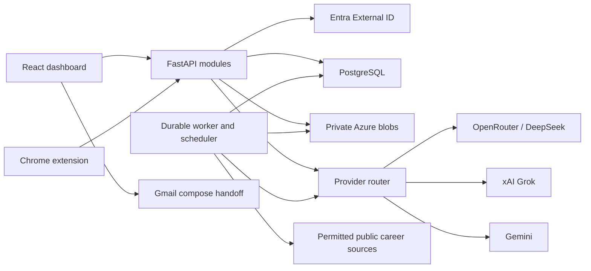

# Three-pillar architecture



## Repository and ownership

```text
apps/web/                   React routes/UI; no service credentials
apps/extension/             MV3 panel, worker, isolated content scripts and event outbox
apps/api/app/modules/       auth, profile, documents, credentials, applications,
                            autofill, email, sources, jobs, notifications, privacy
apps/api/app/providers/     normalized provider contracts/router/adapters
apps/api/app/worker/        document parse, daily scan, export, deletion, cleanup
apps/api/alembic/versions/  Alembic tables/grants/RLS
apps/api/tests/             unit/API/database security
packages/browser-shared/   field/error/message schemas
packages/api-client/       generated OpenAPI client
tests/fixtures/             synthetic forms/docs/feeds/provider responses
tests/e2e/ and tests/evals/  three-pillar journeys and quality corpora
infra/azure/               Bicep/resources/environment parameters
docs/                      contracts, tasks and evidence
```

React assets are included in the FastAPI container; one HTTPS origin for dashboard/API. `/api/v1/*`, `/auth/*`, `/health/*` never fall through to SPA HTML. PostgreSQL/blobs are authoritative. Provider/credential/file access is backend-only; content script receives only values for its selected fields. Synchronous SQLAlchemy handlers do not block the asyncio event loop; network provider/source operations use bounded async clients. No credential/provider SDK in content scripts.

Database connections are separated by role: `copilot_migrator` owns schema, `copilot_runtime` serves owner-scoped application operations under tenant RLS, `copilot_auth` has narrow identity/session bootstrap access, and `copilot_worker` can claim/update durable job metadata only. Every role is non-superuser and has `NOBYPASSRLS`; the worker has an explicit jobs-only policy and cannot read profile or document rows.

Target runtime design uses separately supervised API and worker/scheduler processes, PostgreSQL restart-safe queueing, one-minute scheduler ticks, 60-second leases, 20-second heartbeats, and bounded retries; no Redis. The planned job states are PENDING/RUNNING/SUCCEEDED/PARTIAL/FAILED/CANCELED/SKIPPED, with deletion operations additionally exposing WAITING_IDENTITY_CLEANUP. The current queue model implements QUEUED/RUNNING/SUCCEEDED/FAILED/CANCELED and stage markers; its claim/lease/retry primitives exist, but scheduled ticks, registered handlers, per-kind retry policy, and the planned expanded states remain unfinished. Verify restart and idle behavior before beta. Document parsing should use one resource-limited subprocess; up to four bounded network/provider operations may run concurrently. User-initiated API operations take priority; monitor backpressure is visible.

## Identity and application sessions

FastAPI is the confidential OIDC client for a dedicated External ID email/password/reset flow. The target is to use Authlib; the current implementation performs discovery, exchange, and JWT/JWKS verification directly with `cryptography`, a tracked plan deviation requiring review. Login creates a ten-minute transaction with state, nonce, provider PKCE verifier and exact allowlisted callback/return. Temporary HttpOnly transaction cookie binds the browser. Callback atomically consumes state, exchanges code, verifies signature/issuer/audience/nonce, beta enrollment and immutable directory object/subject identity. Reject arbitrary issuers/redirects. Provider credentials/tokens are not stored in browser or reused as app sessions.

Dashboard cookie `__Host-copilot_session`: random 256-bit opaque value, Secure/HttpOnly/SameSite=Lax/Path=/, no Domain. Store only SHA-256 digest; idle expiry 60 minutes, absolute 12 hours. Cookie mutations require exact Origin and session-bound CSRF. Derive a stable CSRF token using HMAC(service key, raw session token); return it only through authenticated session route and verify its digest. No cross-tab CSRF rotation on every read. Fresh provider authentication within ten minutes is required for export/account deletion/credential replacement; full keys are never revealed.

Extension creates state/S256 challenge in trusted session storage and opens API login via `chrome.identity.launchWebAuthFlow`. API redirects only to configured `https://<extension-id>.chromiumapp.org/auth` after login, carrying a hashed, single-use 60-second app grant bound to account/ID/challenge. Exchange verifies state/PKCE/expiry and issues an opaque bearer app session. No provider refresh token in extension. Both clients map to the same `(issuer,subject)` through the backend client registration. Exact extension Origin allowlist and bearer authentication are both required.

All-client logout revokes application sessions, clears trusted state/outbox, and attempts provider sign-out. Service-worker restart can recover its app session from TRUSTED_CONTEXTS session storage but discards pending field writes. Browser restart requires sign-in; saved provider keys stay encrypted in cloud, session-only keys vanish. Unknown/DELETING/expired/revoked account requests fail. A provider SSO cookie cannot revive a revoked app token.

## Feature flows

- ONBOARDING: upload private originals, parse candidates, confirm facts/style and resolve contradictions before factual use.
- AUTOFILL_TRACKING: extract selected page context → retrieve relevant confirmed facts → router drafts/maps → write bound eligible fields → review → passively observe user's submit → persist distinct evidence/status.
- EMAIL_APPLICATIONS: draft from context/profile → user edits → Gmail UI handoff → user attaches/sends → explicit sent confirmation.
- JOB_MONITORING: schedule local 09:00 → claim owner source job → safe bounded fetch → extraction/matching → deduplicated posting/notification → dashboard badge.

Providers normalize operation-specific schemas; actual key/provider/model/attempt outcomes are owner-scoped and audited without content/secrets. Enable fallback only for consented keys; unknown completion stops. A model never invokes submit/send/fetch/admin tools. All writes/results check account state and relevant revisions before publishing.

## Durable privacy/recovery

Export/deletion use persisted stage markers and bounded retries; exhausted failures alert and remain visible. Account deletion atomically marks DELETING, disables schedules/revokes sessions/keys and cancels queued work; independent deletion journal is written before acknowledgement. Receipt token allows only viewing that deletion operation. Worker purges all owned feature data/documents/keys and records beta operator identity cleanup. Only then report complete, with backup/journal retention disclosed.

Already-dispatched provider/network work cannot be unsent; active jobs recheck deletion/pause before subsequent dispatch and publishing. Never publish a late result into a deleted/switched account. Recovery restores into isolation, replays independent deletion journal, invalidates sessions and reconciles original files before exposure. Shared retained-copy windows and ownership are defined in SECURITY_PRIVACY.
